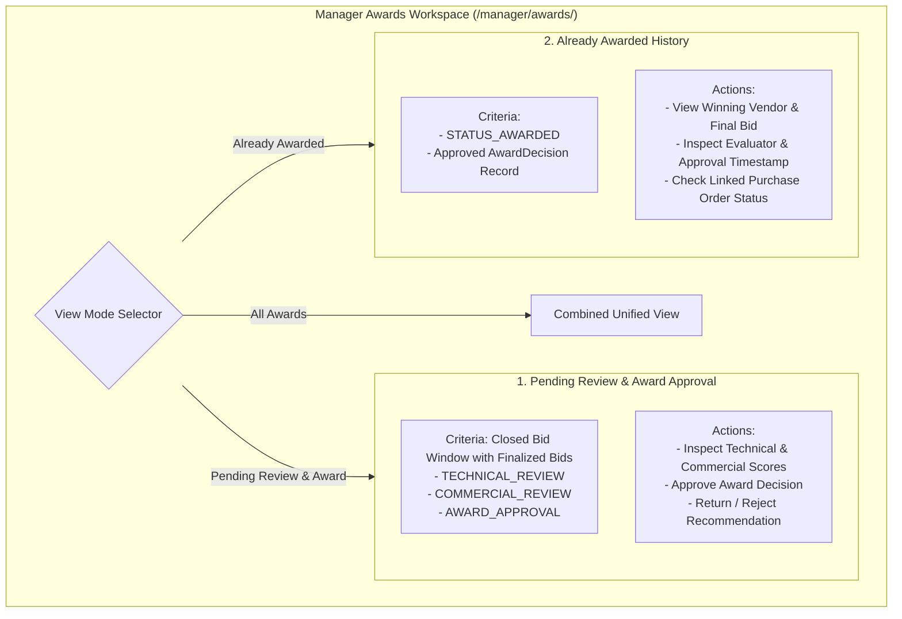

# ProcureSphere 360 — Pending Awards & Dropdown Pagination Removal Implementation Plan

**Target Areas:**
1. **Pending Awards Manager Desk:** Sourcing Events in Review/Approval (`TECHNICAL_REVIEW`, `COMMERCIAL_REVIEW`, `AWARD_APPROVAL`) + Already Awarded Events (`AWARDED`).
2. **Universal Dropdown Pagination Removal:** Complete elimination of pagination limits for all `<select>` dropdowns across the application.
**Authority:** Technical Lead / Principal Software Architect  
**Date:** 2026-11-17  

---

## 1. Problem Diagnosis & Requirements Breakdown

### Issue 1: Pending Awards Desk is Empty & Missing Historical Awards
* **Root Cause in Backend API:**
  In `src/apps/sourcing/api_urls.py` (`PendingAwardsAPIView`), the queryset was hardcoded to:
  ```python
  events = SourcingEvent.objects.filter(status=SourcingEvent.STATUS_AWARD_APPROVAL)
  ```
  - In real workflows, after the bid window closes with finalized bids, sourcing events enter `STATUS_TECHNICAL_REVIEW` and `STATUS_COMMERCIAL_REVIEW` before or during award approval.
  - Currently in the database, there are **0** events in `STATUS_AWARD_APPROVAL`, but **11 events in `STATUS_AWARDED`**, **2 in `STATUS_COMMERCIAL_REVIEW`**, and **11 in `STATUS_TECHNICAL_REVIEW`**.
  - Because `STATUS_AWARD_APPROVAL` was the sole filter, the Pending Awards desk showed a completely empty screen ("0 Pending Awards").
  - Furthermore, events that have **already been awarded** disappeared completely from the desk, leaving the Procurement Manager with no visibility into awarded decisions, winning vendors, and commitment amounts.

### Issue 2: Dropdowns Truncated by Pagination
* **Root Cause in REST API Pagination:**
  - Standard DRF `PageNumberPagination` paginates viewset lists to a default limit (e.g. 25 items).
  - When frontend dropdowns (`<select>`) call endpoints to fetch lists (e.g. vendors, cost centers, departments, categories, events), any records beyond the first page are truncated and invisible.
  - The requirement is clear: **Dropdowns must never have pagination**. Any API request that feeds a dropdown must return the complete set of database records for that organization.

---

## 2. Architecture & Design Specification

### A. Pending Awards Manager Workspace Enhancement

We will restructure `/manager/awards/` and `PendingAwardsAPIView` to provide two clear operational streams:



#### 1. Backend API (`/api/v1/sourcing-events/awards/pending/`):
- **Expanded Scope:** Include events where:
  - `status` is in `[STATUS_TECHNICAL_REVIEW, STATUS_COMMERCIAL_REVIEW, STATUS_AWARD_APPROVAL, STATUS_AWARDED]`, OR
  - `status == STATUS_BID_WINDOW` and `bid_end_date <= timezone.now()`.
  - Must have at least 1 finalized bid (`status in [SUBMITTED, AMENDED]`).
  - Scoped to the manager's organization.
- **Support Filter Parameter:**
  - `?tab=pending`: Returns events awaiting technical/commercial review and award approval.
  - `?tab=awarded`: Returns already awarded events with winning vendor details, award date, and PO status.
  - Default: Returns both sets with a clear `is_awarded` boolean flag.

#### 2. Frontend UI (`templates/manager/awards.html`):
- **Tabbed / Filter Toolbar:**
  - `[ ⏳ Pending Award Decisions (N) ]`
  - `[ 🏆 Already Awarded History (M) ]`
  - `[ All Events (N+M) ]`
- **Updated KPI Cards:**
  - Card 1: `Awaiting Decision` (count of events in technical/commercial review and award approval).
  - Card 2: `Already Awarded` (count of completed awards).
  - Card 3: `Total Commitment Value` (sum of awarded + recommended winning bids).
  - Card 4: `Evaluation Integrity` (dual-scoring verification).
- **Card Rendering:**
  - For pending events: Shows score ranking table, recommended bidder, and `[ Approve Award ]` / `[ Reject / Return ]` buttons.
  - For awarded events: Shows `[ Awarded ]` badge in green, winning vendor card, award approval timestamp, approved by manager identity, and link to inspect the full sourcing/PO dossier.

---

### B. Universal Dropdown Pagination Removal

To eliminate dropdown pagination across the entire application without breaking normal paginated table views:

#### 1. Backend Universal Pagination Bypass (`src/apps/core/pagination.py`)
Enhance `StandardResultsSetPagination.paginate_queryset`:
```python
class StandardResultsSetPagination(PageNumberPagination):
    page_size = 25
    page_size_query_param = "page_size"
    max_page_size = 1000

    def paginate_queryset(self, queryset, request, view=None):
        # Universal Dropdown / Unpaginated Trigger:
        # If any dropdown or unpaginated flag is present, bypass pagination completely.
        paginate_param = request.query_params.get("paginate", "").lower()
        pagination_param = request.query_params.get("pagination", "").lower()
        dropdown_param = request.query_params.get("dropdown", "").lower()
        page_size_param = request.query_params.get("page_size", "").lower()

        if (
            paginate_param in ("false", "0", "no")
            or pagination_param in ("none", "false", "0", "no")
            or dropdown_param in ("true", "1", "yes")
            or page_size_param in ("all", "0", "-1")
        ):
            return None  # Disables pagination in DRF; returns all matching records!

        return super().paginate_queryset(queryset, request, view)
```

#### 2. Frontend Dropdown Audit & Update
Identify and update all dropdown fetch routines across templates to pass `?paginate=false`:
1. `templates/manager/vendor_risk.html` & `vendor_suspension.html`:
   - `fetchManagerAPI('/api/v1/vendors/?paginate=false')` (guarantees all 222+ active/suspended vendors are loaded with zero limits).
2. `templates/sourcing/` templates:
   - Category dropdowns: `/api/v1/vendors/categories/?paginate=false`
   - Vendor invite dropdowns: `/api/v1/vendors/?paginate=false&status=ACTIVE`
   - PR dropdowns: `/api/v1/requisitions/?paginate=false&status=APPROVED`
3. `templates/orders/` templates:
   - Cost center dropdowns: `/api/v1/cost-centers/?paginate=false`
   - Vendor dropdowns: `/api/v1/vendors/?paginate=false`
4. `templates/invoices/` & `contracts/` templates:
   - PO dropdowns: `/api/v1/purchase-orders/?paginate=false`

---

## 3. Implementation Steps & File Modifications

| Step | File | Planned Changes |
|---|---|---|
| **1. Universal Pagination Bypass** | `src/apps/core/pagination.py` | Add `paginate=false`, `dropdown=true`, `page_size=all` bypass in `StandardResultsSetPagination.paginate_queryset` to return `None` (unpaginated). |
| **2. Backend Pending Awards API** | `src/apps/sourcing/api_urls.py` (`PendingAwardsAPIView`) | Expand query to include `TECHNICAL_REVIEW`, `COMMERCIAL_REVIEW`, `AWARD_APPROVAL`, and `AWARDED` events with submitted bids. Support `?tab=pending` and `?tab=awarded`. Include winning bid and award decision details in response. |
| **3. Manager Awards Frontend UI** | `templates/manager/awards.html` | Add segmented tabs (`Pending Decisions` vs `Already Awarded`), render awarded event cards with winning vendor/amount, update KPI metrics, and wire filters. |
| **4. Dropdown Pagination Removal** | `templates/manager/vendor_risk.html`, `templates/manager/vendor_suspension.html`, `templates/manager/dashboard.html` | Update all dropdown fetch calls to use `?paginate=false`. |
| **5. Core Dropdown Endpoints** | ViewSets across `vendors`, `sourcing`, `orders`, `organization` | Verify that passing `?paginate=false` returns all organization-scoped records cleanly. |

---

## 4. Verification Criteria (Without running test suites)

1. **Pending Awards Workspace (`/manager/awards/`):**
   - Events in `TECHNICAL_REVIEW` and `COMMERCIAL_REVIEW` that have submitted bids appear under "Pending Award Decisions".
   - The 11 already `AWARDED` events in the database appear under "Already Awarded History" with winning vendor, award amount, and approval metadata.
   - Screen is never empty when valid sourcing events exist.
2. **Dropdown Pagination:**
   - Vendor dropdowns on the Sanctions and Suspension Desks show all organization vendors.
   - Calling `/api/v1/vendors/?paginate=false` returns a plain JSON array of all vendors without `next`, `previous`, or 25-record caps.
   - No dropdown truncates records.
