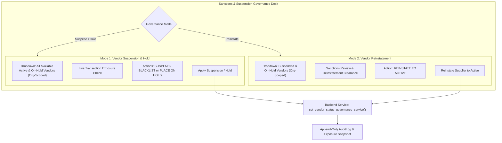

# ProcureSphere 360 — Vendor Suspension & Reinstatement Module Implementation Plan

**Target Module:** Supplier Governance, Sanctions & Suspension Desk (`/manager/vendor-risk/?tab=suspension` & `/manager/vendor-suspension/`)  
**Authority:** Technical Lead / Principal Software Architect  
**Date:** 2026-11-17  

---

## 1. Executive Summary & Problem Diagnosis

Based on the inspection of the database (222 records in Supabase `vendors_vendor`) and the live UI:

### Root Causes of Current Behavior
1. **Dropdown Pagination Truncation (Missing DRF `page_size_query_param`):**
   - Django REST Framework's default pagination (`rest_framework.pagination.PageNumberPagination`) has `page_size_query_param = None`.
   - When the frontend executed `fetchManagerAPI('/api/v1/vendors/?page_size=500')`, DRF silently ignored `?page_size=500` and returned only the default 25 records.
   - Because the API ordered by `-created_at`, only the 25 most recently created vendors (which were test fixtures generated during automated test runs) were returned to the frontend.
   - Real enterprise vendors of the organization (Cisco Systems, Acme Technologies, Apex Cloud, Sai Networks, Alpha Technologies, etc.) were pushed to later pages and never loaded in the dropdown.

2. **Cross-Tenant Organization Leak in `VendorViewSet`:**
   - In `src/apps/vendors/api_urls.py` (`VendorViewSet.get_queryset`), `elif not user.is_superuser and not can_view_governance(user):` skipped organization scoping for users with `can_view_governance(user) == True` (such as Procurement Managers).
   - This caused the API to return vendors from all tenants and test organizations (`Contract Test Org ED90F8`, `QA Org ...`), polluting the dropdown with irrelevant and rejected records.

3. **Mixing Suspension and Reinstatement in a Single Generic Dropdown:**
   - The dropdown in the Governance Action Formulation card populated all non-draft vendors indiscriminately (including `REJECTED`, `SUSPENDED`, and `ACTIVE` vendors).
   - A manager wishing to **suspend** a vendor saw already-suspended and rejected vendors.
   - A manager wishing to **reinstate** a vendor had to hunt through active vendors to find suspended suppliers.

---

## 2. Proposed Architectural Design: Separation of Workflows

To provide a clean, unambiguous user experience and enforce rigid business rules, we will split the Governance Action Desk into two dedicated operational workflows:



### Module 1: Vendor Suspension & Hold
- **Target Audience:** All available **ACTIVE** (and optionally ON_HOLD) suppliers belonging strictly to the manager's organization.
- **Allowed Actions:**
  1. `SUSPENDED`: Suspend / Blacklist (Material breach, sanctions, fraud, severe regulatory non-compliance). Blocks new RFQ/RFP invitations, disqualifies pending bids, and prohibits PO issuance.
  2. `ON_HOLD`: Place On Hold (Temporary compliance review, expiring certifications, pending KYC updates). Temporarily restricts bidding and PO creation.
- **UI Elements:**
  - Header: `⛔ Vendor Sanctions & Administrative Suspension`
  - Subtitle: *"Select an active supplier of your organization to place on administrative hold or execute sanctions/suspension."*
  - Dropdown: Dynamically populated with all active vendors of the current organization, sorted alphabetically by name.

### Module 2: Vendor Reinstatement
- **Target Audience:** Strictly **SUSPENDED** and **ON_HOLD** suppliers belonging to the manager's organization.
- **Allowed Actions:**
  1. `ACTIVE`: Release / Reinstate to Active. Restores normal operating standing, allowing participation in sourcing events, bid submission, and purchase order execution.
- **UI Elements:**
  - Header: `🔄 Vendor Reinstatement Desk`
  - Subtitle: *"Select a suspended or on-hold supplier to review resolution notes and restore full operating credentials."*
  - Dropdown: Dynamically populated only with suppliers requiring reinstatement.

---

## 3. Detailed Technical Implementation Steps

### Step 1: DRF Pagination Fix (`src/apps/core/pagination.py` & `src/config/settings/base.py`)
1. Create `StandardResultsSetPagination`:
   ```python
   from rest_framework.pagination import PageNumberPagination

   class StandardResultsSetPagination(PageNumberPagination):
       page_size = 25
       page_size_query_param = "page_size"
       max_page_size = 1000
   ```
2. Set in `settings/base.py`:
   `REST_FRAMEWORK["DEFAULT_PAGINATION_CLASS"] = "apps.core.pagination.StandardResultsSetPagination"`
3. **Impact:** API calls with `?page_size=500` or `?page_size=1000` will successfully return all organization vendors in a single payload without truncation.

### Step 2: Strict Multi-Tenant Organization Scoping in `VendorViewSet` (`src/apps/vendors/api_urls.py`)
1. Enforce strict organization filtering for all authenticated non-superusers:
   ```python
   user_org = getattr(user, "effective_organization", None) or getattr(user, "organization", None)
   if not user.is_superuser:
       if user_org:
           qs = qs.filter(
               Q(organization=user_org)
               | (Q(organization__isnull=True) & Q(created_by__organization=user_org))
           )
       else:
           qs = qs.none()
   ```
2. Order results alphabetically by `legal_name` (`qs.order_by("legal_name")`) so all enterprise vendors (Acme Technologies, Cisco Systems, etc.) are immediately easy to locate.

### Step 3: UI Redesign in `templates/manager/vendor_risk.html` & `templates/manager/vendor_suspension.html`
1. **Interactive Mode Switcher:**
   Add a segmented pill control above the action formulation card:
   ```html
   <div class="btn-group p-1 bg-slate-100 rounded-pill mb-3" role="group">
       <button type="button" class="btn btn-sm rounded-pill fw-bold active" id="modeSuspendBtn" onclick="switchGovMode('suspend')">
           <i class="fa-solid fa-ban text-danger me-1"></i> Suspend / Hold Supplier
       </button>
       <button type="button" class="btn btn-sm rounded-pill fw-bold text-muted" id="modeReinstateBtn" onclick="switchGovMode('reinstate')">
           <i class="fa-solid fa-rotate-left text-success me-1"></i> Reinstate Suspended Supplier
       </button>
   </div>
   ```
2. **Dynamic Population Logic:**
   - In `suspend` mode:
     - Populate dropdown with suppliers where `status === 'ACTIVE' || status === 'ON_HOLD'`.
     - Set default action to `SUSPENDED` (options: `SUSPENDED`, `ON_HOLD`).
     - Button: `<i class="fa-solid fa-ban me-1"></i> Apply Suspension / Hold`.
   - In `reinstate` mode:
     - Populate dropdown with suppliers where `status === 'SUSPENDED' || status === 'ON_HOLD'`.
     - Set default action to `ACTIVE` (option: `ACTIVE`).
     - Button: `<i class="fa-solid fa-rotate-left me-1"></i> Reinstate to Active`.
3. **Deep Linking Integration:**
   - When arriving from Dashboard Watchlist with `action=SUSPENDED`, open in `suspend` mode with the vendor selected.
   - When arriving with `action=REINSTATE` (or `action=ACTIVE`), automatically toggle to `reinstate` mode with the suspended vendor pre-selected.

### Step 4: Ensure Complete Database-Backed Persistence & Audit Trail
- Calls `POST /api/v1/vendors/{id}/governance-status/` with `{ status, reason }`.
- Validates state transitions via `set_vendor_status_governance_service`.
- Updates `Vendor.status`, writes an immutable `AuditLog` entry, and refreshes the live UI and KPIs dynamically.

---

## 4. Verification & Testing Checklist

| Step | Verification Criteria | Expected Outcome |
|---|---|---|
| 1. Pagination | Request `/api/v1/vendors/?page_size=1000` | Returns all organization vendors (191+ in HPE org), not capped at 25 |
| 2. Scoping | Log in as `procmgr@hpe.com` | Only HPE vendors (Acme, Cisco, Apex, Sai Networks, etc.) appear; no cross-tenant QA vendors |
| 3. Suspension Dropdown | View "Suspend / Hold Supplier" mode | Only ACTIVE/ON_HOLD vendors appear; no suspended or rejected vendors |
| 4. Reinstatement Dropdown | View "Reinstate Suspended Supplier" mode | Only SUSPENDED/ON_HOLD vendors appear |
| 5. Action Execution | Suspend active vendor (e.g. Acme) with mandatory reason | Vendor status becomes SUSPENDED; audit log recorded; vendor moves to Reinstatement list |
| 6. Reinstatement Execution | Reinstate suspended vendor with justification | Vendor status returns to ACTIVE; vendor returns to Suspension list |
| 7. Dashboard Deep Link | Click "Suspend" or "Reinstate" on dashboard | Correct mode opens with target vendor pre-selected |
